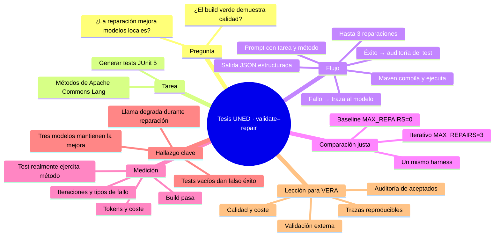
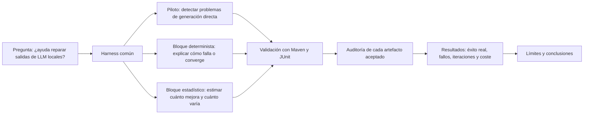
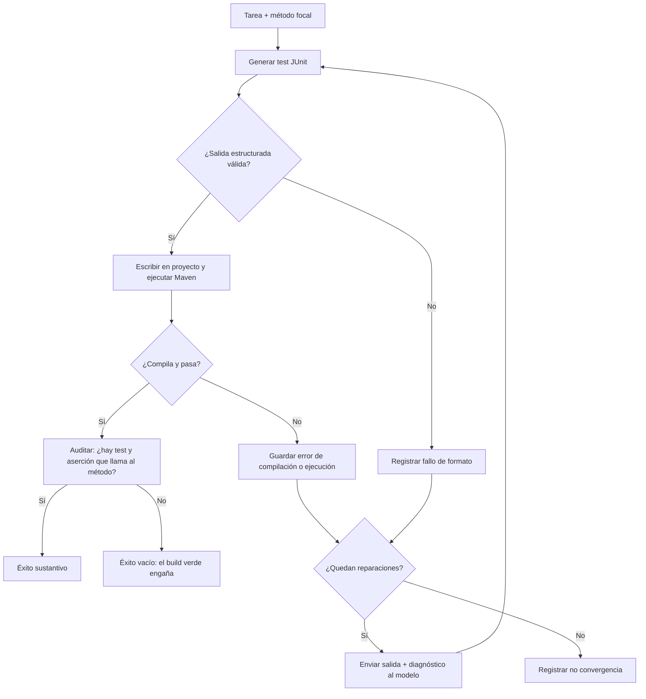
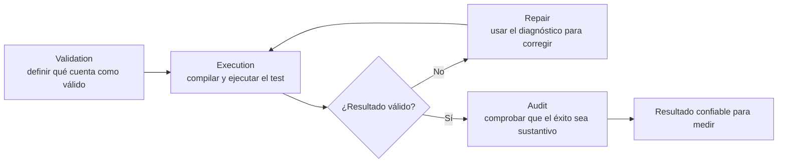
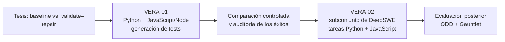

# Resumen práctico y metodológico

**Fuente:** María Isabel González Sánchez, *Agentic Validate–Repair Workflows for Local Large Language Models: A Controlled Empirical Evaluation on Automated Unit Test Generation* (tesis de máster, UNED, septiembre de 2026). [PDF local](paper/1791733959420.pdf).

La tesis pregunta si un ciclo sencillo de validación y reparación puede mejorar la fiabilidad de modelos locales en una tarea real de ingeniería de software. La tarea elegida es generar tests unitarios Java para métodos de Apache Commons Lang. El caso es útil porque el resultado se puede ejecutar y medir, pero también revela un problema central: un resultado verde puede ser engañoso si el test no verifica nada.

## Método, paso a paso

```text
Tarea + fuente del método focal
              ↓
LLM genera un test JUnit en JSON estructurado
              ↓
Se extrae el código y se escribe en el proyecto
              ↓
Maven compila y ejecuta el test generado
       ┌──────┴──────┐
     pasa           falla
      ↓               ↓
auditarlo       guardar traza y devolver
                 código + error al LLM
                      ↓
               nueva versión → Maven
```

1. **Contexto y generación.** Para cada método focal, el modelo recibe la tarea y el código del método. Debe producir una respuesta estructurada que contenga el código Java y una nota breve. Las respuestas que rompen el formato también se registran: una solución correcta dentro de una envoltura que el sistema no puede parsear no llega a validarse.
2. **Validación ejecutable.** El artefacto se coloca en el árbol del proyecto, como un test normal. Maven compila y ejecuta ese test con JUnit 5. Un fallo puede indicar salida inválida, error de compilación, test fallido o error/timeout de ejecución.
3. **Reparación con evidencia.** Si falla, el mismo modelo recibe la versión más reciente del test y el diagnóstico concreto del build. Se limita el ciclo a tres reparaciones; contando la generación inicial, se permiten hasta cuatro llamadas. Si el build pasa, el ciclo termina.
4. **Auditoría del éxito.** Todo artefacto aceptado se inspecciona para comprobar que declara una prueba (`@Test`), contiene una aserción y que esta invoca el método focal. Solo entonces se cuenta como éxito sustantivo.

Una decisión clave del diseño es mantener un **harness único**: baseline y tratamiento comparten modelo, prompt, parser y comando de validación. La única variable cambiada es `MAX_REPAIRS`: **0** para generar y validar una vez; **3** para permitir el ciclo. Así se atribuye la diferencia observada al presupuesto de reparación, en lugar de a dos implementaciones distintas.

## Diseño del experimento

| Bloque | Modelos y tareas | Repeticiones | Pregunta |
|---|---|---:|---|
| Piloto | Un modelo y `CharUtils.toChar` | Exploratorio | ¿Qué problemas aparecen al generar directamente para un proyecto real? |
| Determinista | Llama 3.1 8B y Qwen 2.5-Coder 7B; 10 métodos de `StringUtils`; temperatura 0 | Una por método y condición | ¿Por qué converge o se atasca cada intento? |
| Estadístico | Los dos anteriores, Qwen3 8B y Gemma 4 E4B; 20 métodos de `StringUtils`, `CharUtils` y `BooleanUtils`; temperatura 0,7 | 15 por método y condición; 2.400 ejecuciones | ¿Cuánto mejora el ciclo y cuánto varían sus resultados y coste? |

El bloque determinista permite inspeccionar salidas y errores concretos. El estadístico introduce muestreo y repeticiones para estimar el efecto con más fiabilidad; el análisis tiene en cuenta que algunos métodos son más difíciles que otros. Las dos condiciones se ejecutan de forma independiente, no como pares de una misma generación.

Se persiste por intento el código generado (o la respuesta bruta si no se pudo parsear), la traza completa, el veredicto, el número de iteración y los tokens. Esto permite estudiar después tanto las reparaciones exitosas como los callejones sin salida, sin volver a llamar al modelo.

## Fallos que el método distingue

La inspección de iteraciones muestra que “no reparó” no es una única causa:

- **Corrupción superficial:** aparece un carácter espurio en código que por lo demás era correcto.
- **Error semántico:** el modelo entiende mal el contrato del método.
- **Oscilación:** corrige un defecto y crea otro; cambia de versión sin converger.
- **Incumplimiento de formato:** el test puede ser correcto, pero la respuesta no respeta el JSON o el formato esperado.

La clasificación importa para decidir qué mejorar. Un bug del código requiere feedback y reparación; una envoltura defectuosa quizá pueda resolverse con parsing o saneamiento determinista; la oscilación puede requerir límites y criterios de parada.

## Resultados principales

En el bloque determinista, Qwen 2.5-Coder pasa de **4/10 a 6/10** métodos y Llama 3.1 de **1/10 a 3/10**. La mejora existe, aunque es modesta: dos métodos adicionales para cada modelo.

En el bloque estadístico, la tasa de “compila y pasa” mejora en los cuatro modelos:

| Modelo | Sin reparación | Con reparación | Tras auditoría sustantiva |
|---|---:|---:|---:|
| Llama 3.1 8B | 17,7 % | 54,7 % | 22,3 % |
| Qwen 2.5-Coder 7B | 25,7 % | 46,3 % | 45,0 % |
| Qwen3 8B | 42,7 % | 52,3 % | 52,0 % |
| Gemma 4 E4B | 31,3 % | 66,7 % | 65,3 % |

La última columna corresponde a la condición con reparación, contando solo tests que ejercitan el método. De los **1.012** artefactos que el build aceptó, **10,7 %** eran vacíos. El efecto se concentró en Llama 3.1: **97 de sus 164** éxitos con reparación no probaban nada. Su ventaja aparente, **+37 puntos**, se reduce a **+4,7 puntos** y deja de ser estadísticamente significativa al excluirlos. Los resultados de los otros tres modelos apenas cambian.

El ciclo también consume más recursos: aproximadamente **3–6 veces** los tokens de la generación directa. El beneficio marginal tiende a reducirse en las reparaciones posteriores. El estudio estima un odds ratio de 3,74 para la condición con reparación bajo el criterio inicial de build verde; ese agregado debe leerse junto a la auditoría, que demuestra que ese criterio inicial no basta para todos los modelos.

## Qué nos enseña para VERA

1. Comparar baseline y ciclo sobre el mismo harness y variar solo el presupuesto de reparación.
2. Usar resultados observables del entorno como feedback, no pedir al modelo que juzgue por sí solo si acertó.
3. Guardar cada salida y diagnóstico; reportar por separado fallos de formato, compilación y ejecución.
4. Auditar los resultados aceptados. El validador puede dar un falso éxito si su criterio es demasiado débil.
5. Medir calidad sustantiva y coste junto a la tasa de éxito. Más reparaciones no son automáticamente mejores.

El estudio se refiere a generación de tests Java para Apache Commons Lang, no a reparación general de cualquier programa. Usar otro proyecto, tarea, modelo o hardware en VERA-01 será una adaptación; conviene conservar la comparación y anotar esos cambios.

## Mapa mental



## Partes del estudio y cómo encajan

Este esquema resume el argumento de la tesis: parte de una pregunta práctica, controla la comparación, mide el resultado y luego audita si el criterio de éxito refleja calidad real.



## El ciclo experimental en detalle



## De dónde viene VERA

En `prompts.md`, **Loom VERA** se define como **Validation · Execution · Repair · Audit**: las cuatro piezas que queremos estudiar en nuestro POC. El acrónimo es el nombre del proyecto; **no es el nombre que la autora da a su tesis o a su método**.



**Validation** y **Execution** están relacionadas, pero cubren decisiones distintas: *Execution* corre el artefacto y produce observaciones; *Validation* aplica el criterio que interpreta esas observaciones. En la tesis, por ejemplo, Maven puede terminar correctamente aunque no haya ejecutado ningún test; la auditoría detecta ese hueco en el criterio.

## De la tesis a las fases de Loom VERA



VERA-01 conserva la comparación directa frente a reparación, pero adapta lenguaje y tarea. VERA-02 añade tareas de repositorio más amplias con DeepSWE; si usamos solo una selección o cambiamos su harness, lo reportaremos como evaluación VERA y no como puntuación oficial del benchmark. ODD + Gauntlet se comparará después, contra las líneas base ya medidas.
